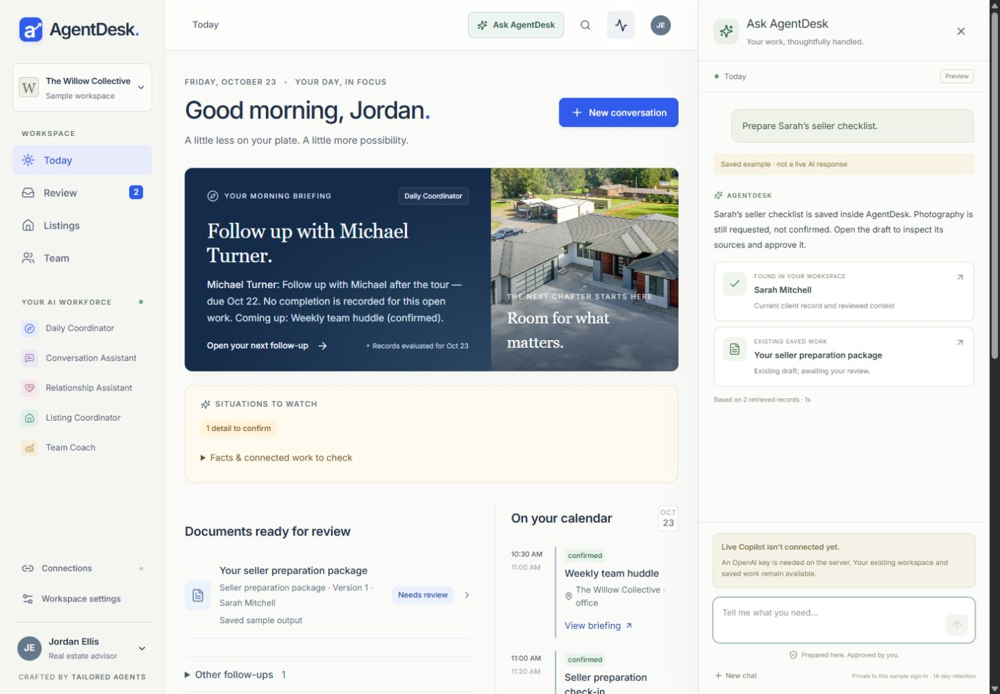
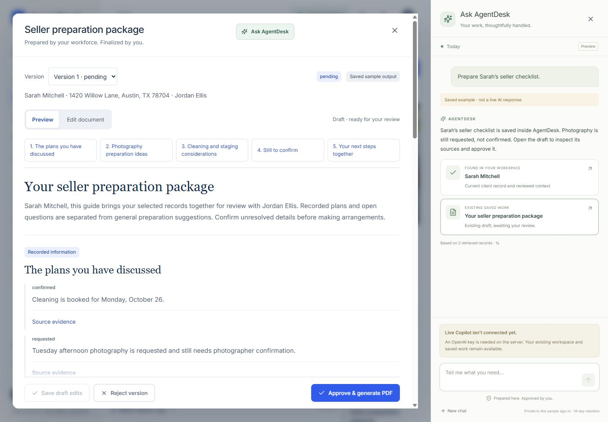
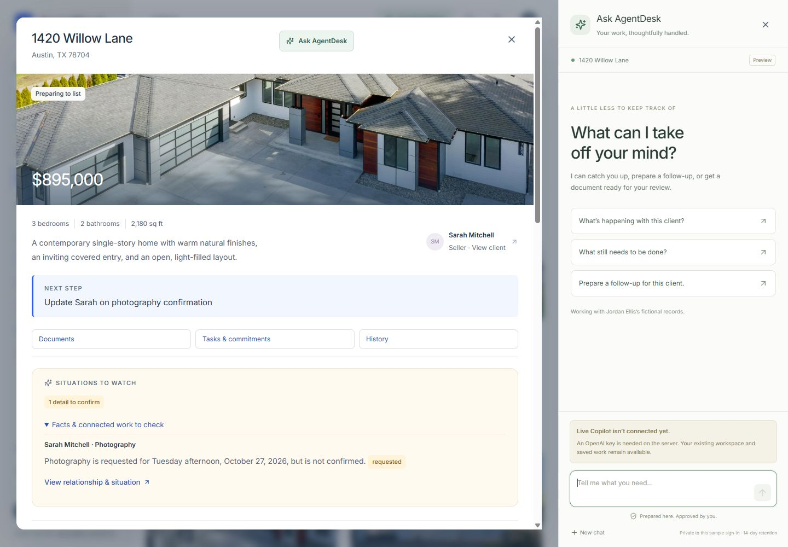
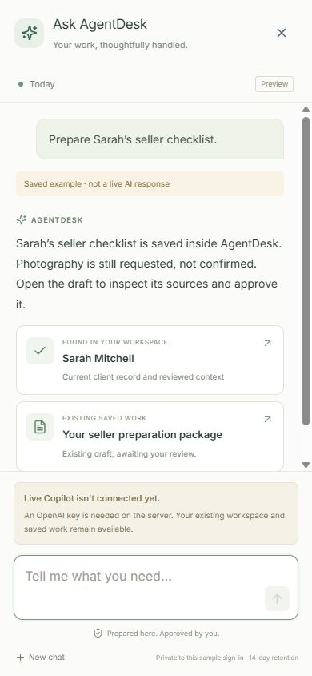
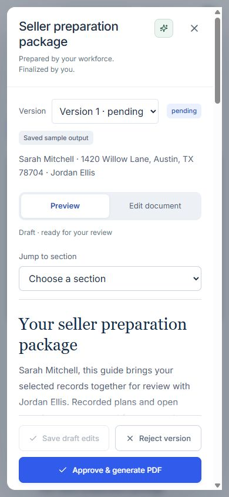
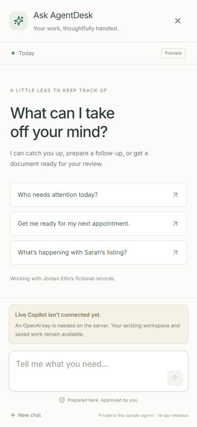

# Web Copilot — controlled preview

Implemented on `codex/web-copilot`, based on the validated `752abd8` demonstration. The Render Blueprint explicitly sets `AGENTDESK_COPILOT_ENABLED=false`. This branch must not replace the Friday demonstration until live evaluation succeeds.

The implementation connects an OpenAI Responses tool loop to real AgentDesk domain services. It includes an Ask AgentDesk side panel, mobile conversation view, persisted private chat, bounded execution, recoverable requests, and links to actual saved reviews/documents. It does not use prompt-string matching to manufacture successful business outcomes.

**Release status: implemented and tested with controlled providers; live model orchestration remains unverified.** No authorized OpenAI key was available on October 22, 2026. The live evaluation command was run and explicitly reported that no live calls were made. Do not describe the fictional browser example as a live AI demonstration.

## Implemented tools

| Tool | What it does | What actually persists |
| --- | --- | --- |
| `find_records` | Finds assigned sample clients/properties using a literal fragment from the current request. Multiple matches require clarification. | Nothing; selected references stay in the owner-scoped chat. |
| `day_overview` | Retrieves current priorities, follow-ups, appointments, activity, aggregate sample team counts, and supported product capabilities. | Nothing. |
| `client_context` | Retrieves current reviewed intelligence, source references, conversation history, tasks, commitments, recommendations, situation changes, workstyle, reviews and documents. | Nothing. Historical/pending content is distinguished from reviewed facts. |
| `read_review` | Reads an authorized package and source; supplies a direct review link. | Nothing; no decisions are applied. |
| `prepare_follow_up` | Reuses current matching work or invokes the existing recommendation preparation pipeline. | A conversation and pending review package when new work is needed. No delivery or CRM synchronization. |
| `capture_interaction` | Submits the current user message verbatim to the existing conversation analysis pipeline. Unidentified showing properties remain null. | Saved source and proposed notes, tasks, questions, messages and supported situation/task changes. Business effects still require the existing review. |
| `prepare_document` | Reuses current seller/appointment documents or prepares a new version. Existing versions refresh through the existing reviewed-fact service; new documents use the existing AI generator and evidence validators. Supports appointments without clients, including the team huddle. | A pending document version, source snapshot and existing audit history. Approval and PDF finalization stay in the document editor. |
| `revise_message` | Applies the existing shorter/natural/professional rewrite service and saves the pending draft. | Pending message wording plus an idempotent edit receipt. Original wording remains available for the existing review audit/workstyle flow. Reviewed messages cannot be rewritten. |

The preparation flows previously located inside web route handlers now live in shared `conversation-preparation.ts`, `follow-up-preparation.ts`, and `preparation.ts`. The existing routes and Copilot use these same services. Domain validation, revision checks, approval transactions, PDF generation and sample reset remain authoritative.

Not implemented: arbitrary task mutations, completing tasks, changing bookings, approving through chat, sending messages, external CRM writes, browsing, shell access, general document prose rewriting, or private CRM pilot tools. Task creation and supported situation-driven updates are proposals from the existing conversation pipeline. Message polishing supports the three existing rewrite styles.

The individual CRM pilot was inspected: its `status`, `leadContext`, `prepare`, proposal, exact-content approval, execution and readback operations use separate Auth.js identities and database authorization. None are exposed through the sample Copilot. Adding a pilot adapter requires explicit individual authorization and dedicated isolation tests; the sample agent switcher must never supply that identity.

## Architecture and security

`copilot/web.ts` is the web identity adapter. It checks the feature flag and existing sample session, fixes the workspace to the dedicated fictional workspace, validates the selected sample agent, and derives a chat owner from the authenticated session plus an opaque HttpOnly browser cookie. It never trusts a model-selected workspace/member/agent scope. A new sample sign-in establishes a new private chat scope; this is not an individual production account system.

`copilot/engine.ts` is channel independent. Its inputs are a trusted principal, conversation/request identifiers, user text and validated record context. The model plans with strict function schemas. The executor validates arguments again, reloads authorized records, enforces record relationships, and returns validated result envelopes and record targets. The server assembles artifact cards from actual service results. Models cannot invent card links or approve an artifact by wording a reply differently.

`copilot/tools.ts` implements least-privilege reads and preparation. All detailed results stay within the selected sample agent. The only wider read is aggregate fictional team counts. Ambiguous searches grant neither client; a new named subject clears the earlier selection. Current client context must be inspected before client work is prepared. Page context cannot reference another agent's records or pair a client with someone else's property.

Retrieved notes, transcripts, names, previous chat and tool data are explicitly untrusted model input. They cannot expand the registry or authorization. The conversation capture tool accepts no model-generated transcript, preventing invented interaction text from being promoted into source evidence. Pending proposals and chat are never written directly into reviewed client facts.

Responses use `store:false`, strict function schemas, sequential calls and structured final output. Returned citation IDs are checked against this turn's retrieved results. Common unsupported action claims are rejected; artifact state comes from services. These checks are not a proof that every natural-language sentence is semantically grounded. Adversarial live evaluation and human inspection remain release requirements. The integration follows [OpenAI's function-calling documentation](https://developers.openai.com/api/docs/guides/function-calling), including replaying response output with tool results.

Limits per request:

- 110-second provider execution budget; 120-second route limit; 180-second database lease.
- At most 7 planning iterations, 10 tool calls, and 3 successful preparation operations.
- At most 14 provider calls, including nested preparation services. No further call begins after reported usage reaches 120,000 input or 30,000 output tokens. The final in-flight call may cross that threshold; each service also retains its own finite output limit.
- Orchestration input is capped at 120,000 serialized characters, a tool data payload at 45,000 characters, user text at 8,000 characters, and a reply at 2,400 characters.
- 12 web requests per owner per 10 minutes, plus existing preparation-service limits. The existing in-process limiter is suitable for the current single-instance preview; use a shared limiter before horizontal scaling.

Logs contain status, durations, tool counts and reported token usage, not prompts, client names, provider responses, tokens or credentials. Necessary chat/checkpoint content is retained in the database under the conversation owner, not copied into general application logs.

## Persistence, recovery and retention

Migration `0011_copilot.sql` adds conversations, turns/checkpoints/leases, and pending-message edit receipts. Conversation ownership includes workspace, session/browser owner and sample agent. The existing fictional reset also clears sample Copilot conversations and receipts.

Each turn binds a caller-generated UUID to exact text and page context. Concurrent requests serialize under a database conversation lock. A completed retry returns the saved result. Planned calls are checkpointed before execution; stable operation UUIDs reuse existing domain idempotency. Successfully saved work survives a later model failure. A retry re-reads retrieval context, recovers unfinished calls and retains successful writes. Expired leases permit recovery and fence the previous worker from saving chat checkpoints.

This is bounded foreground processing, not a background queue. There is no worker promising to continue after a stopped server. The UI polls persisted status while a request is running; an expired lease becomes a recoverable stopped request. If the browser disconnects after a save, open the chat and retry that request instead of submitting unrelated duplicate work.

Chats have a fixed 14-day expiry and a 60-turn cap. Expired chats are inaccessible and deleted on the next Copilot conversation access. For installations requiring physical deletion on a fixed clock regardless of traffic, schedule `DELETE FROM copilot_conversations WHERE expires_at <= now()` using the deployment's approved maintenance mechanism. No external scheduler was introduced. **New chat** explicitly deletes that owner's conversation/checkpoints; saved domain proposals/documents remain. It is unavailable during an active lease.

Document reuse compares the latest saved source snapshot with current authorized sources, ignoring retained historical citations. An explicit new version preserves the product/version lineage. When several products match, a selected document resolves the ambiguity; otherwise Copilot asks which document is intended.

## Web experience

Ask AgentDesk appears in the main toolbar and record dialogs only when the server feature flag is enabled. On desktop the 420px panel sits beside the page or document editor. On mobile it uses the full viewport, readable message text and a persistent composer. The existing navigation and review controls remain available.

Context includes Today, Team, selected client, selected property, selected review and document. Opening a client/property owned by another fictional sample agent selects that agent's separate Copilot chat scope. Direct result cards open the actual client, review, appointment, task or versioned document. Mobile handoff closes the chat to show the destination; reopening restores saved history.

The missing-key state disables submission and explains the connection requirement. It does not fake a successful response. Test-injected example turns display **Saved example · not a live AI response**. No example route or mock provider is exposed by the production API.

## Validation performed — October 22, 2026

- TypeScript: passed.
- Full suite: 192 tests, 190 passed, 2 PostgreSQL-only tests skipped in the PGlite run.
- PostgreSQL 17: existing domain/CRM/workstyle checks passed (80), and all 34 Copilot checks passed without skips.
- Next.js production build: passed.
- Production HTTP smoke: passed with Copilot disabled and enabled, using separate disposable PostgreSQL databases. Both runs also exercised existing approvals, PDF immutability/downloads, calendar export, situation changes, CRM identity isolation and sample-only reset. Readiness was 14ms in both local runs.
- Copilot HTTP checks: authenticated/disabled boundary, same-origin enforcement, unknown-field rejection, foreign record rejection, owner-private history, honest missing-provider failure, and owner-only deletion passed.
- Responses SDK contract: a local controlled provider exercised actual SDK function-call output replay, structured parsing, `store:false`, strict tool definitions, and usage accounting. This is not a live reasoning evaluation.
- Browser: inspected 1440×1000 desktop and 390×844 mobile. Verified real saved-document handoff, simultaneous desktop document/chat interaction, mobile handoff/reopening, listing/Review/Team context, prompt selection, disconnected submission, persisted history and clearing disposable chat. No browser errors/warnings were captured.

Copilot tests include ambiguity, changed subjects/pronouns, strict scope, injected record instructions, forbidden tools, review preservation, current document reuse/new versions, saved verbatim interaction proposals, actual structured task approval, real follow-up persistence/reuse, persisted message revision, appointment briefing creation without an invented client, concurrent turns, request fingerprint conflicts, lost leases, retry recovery, retention, reset, failed-tool output replay, unsupported integration partial help and invented citation/action rejection.

Representative local PostgreSQL fixture timings (entire test cases, not OpenAI latency):

| Scenario | Duration | Provider status |
| --- | ---: | --- |
| Find client → retrieve context → saved seller artifact | 157ms | Scripted planning; real database/services |
| Interaction capture, retry and structured task approval | 513ms | Local controlled response |
| Message rewrite, retry and approval protection | 851ms | Local controlled response |
| Follow-up creation and reuse | 308ms | Local controlled response |
| New appointment briefing | 219ms | Local controlled response |
| Actual SDK two-step tool loop | 89ms | Local controlled response; synthetic 200 input/120 output tokens |

These figures cannot be used to price live Copilot or promise its response speed. Real reported input/output tokens, provider-call counts, per-tool duration and turn duration are captured when OpenAI responds. Failed requests may not include provider usage. No dollar estimate or real model latency is established.

## Live evaluation and release gate

Keep production disabled. In an isolated preview set `AGENTDESK_COPILOT_ENABLED=true`, provide `OPENAI_API_KEY` server-side, and optionally set `OPENAI_COPILOT_MODEL`; otherwise it uses the existing `OPENAI_MODEL` default (`gpt-6.1-sol`, low reasoning). No browser credential is accepted.

Run `npm run test:copilot:live` with `COPILOT_LIVE_EVAL=fictional-only` and an authorized key. The script ignores the configured database URL, creates an isolated temporary PGlite workspace, runs ten bounded fictional scenarios, reports outcomes/usage, and cleans up its own temporary data. It returns a distinct unverified result when a key is missing. It does not enable the website flag or touch Render.

The scenarios cover Sarah's listing, outstanding work, a follow-up, natural wording, an updated checklist, priorities, next appointment, workforce activity, Michael's ambiguous showing notes, and a prohibited approval/sending request. Inspect source grounding and actual saved artifacts, not only completed HTTP status. Add live ambiguous-name and malicious-record variants before release. The deterministic tests establish permission and persistence boundaries but do not establish that the model consistently chooses the right tools or asks the right clarification.

Friday fallback: use the already validated main-branch demonstration. The screenshots below contain explicitly labeled saved examples and real existing sample records, not live model success. Do not merge/enable this preview just to remove the missing-key message.

## Future SMS boundary — no integration added

A future channel adapter may authenticate a verified individual, resolve brokerage/member/assignment scope server-side, obtain or create an owned conversation and pass the same channel-independent request to the engine. It must use a pilot-specific tool adapter backed by existing `CrmService` authorization, rather than reusing the fictional sample principal.

It must separately implement phone verification, signed provider webhooks, inbound deduplication, consent/compliance, abuse controls, rate limiting, opt-outs, and secure short-lived authenticated review links. The current artifact representation has typed record IDs and status suitable for alternate presentation. It intentionally contains no arbitrary model-generated URLs. A text such as “go ahead” must not bypass structured review or exact-content external authorization.

No Twilio package, phone-number purchase, webhook, inbound/outbound SMS or external messaging change was added. Durable workers should be introduced only if a future channel needs execution beyond the current foreground request lifetime.

## Browser evidence

