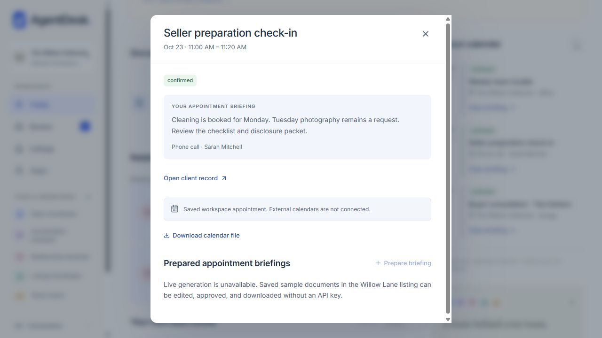

# AgentDesk usability and product audit

**Audit date:** October 22, 2026
**Application baseline:** `2b5f34ee04e4e19bf3544830e0f3d829804329d5`
**Scope:** existing fictional demonstration and separate private-pilot interface.
**Decision requested:** choose improvements from this report before implementation. **No application redesign, refactor or product-code fix was made during this audit.**

## Product judgment

**AgentDesk is visually convincing, but it is not yet effortless enough for six ordinary agents to adopt without training.** It can support a strong guided presentation. A novice working alone would repeatedly need help distinguishing prepared work, approved work, completed work and work actually sent to a client. An experienced agent would understand more, but still spend too much time reopening context, scrolling through explanations and navigating between related records. The pilot currently feels more like a technical operations console than the polished daily assistant promised by the sample.

The most serious finding is a correctness problem: **after a changed plan is approved, the appointment dialog can continue presenting the previous plan as “YOUR APPOINTMENT BRIEFING” without an outdated-information warning.** Silent loss of conversation notes and Review jumping to another client's package are additional release priorities.

The strongest experience is the seller document: readable output, meaningful source distinctions, immutable approved PDFs, explicit review, a useful refresh-from-approved-facts action, and a working unsaved-edit guard. Those patterns should be reused elsewhere. The premium typography, restrained colors and property imagery should remain. More features or decorative polish will have less impact than completing the existing workflows.

**Would an agent enjoy daily use?** Some would enjoy the prepared drafts and documents. In its present form, the application itself would also become another administrative burden for many of them. That is an expert assessment from observed behavior, not a claim about a completed user study. Validate the improvements with the six intended agents before declaring the product intuitive.

## Method, scoring and limits

The actual sample application ran at localhost:3003 against a new, isolated PGlite directory, `.agentdesk/ux-audit-2026-10-22`. The existing saved demonstration and production workspace were not edited. Audit actions used fictional clients only. Desktop inspection used 1280×720; responsive inspection used a verified 390×844 CSS viewport. Mobile means browser responsive testing, not a physical phone, soft keyboard, screen reader or hardware microphone test.

A local disposable preview at localhost:3004 rendered the **existing PilotWorkspace component and existing application CSS** against fictional in-memory JSON responses. It allowed inspection of connected, disconnected, partial-refresh, submitted and unknown-outcome states without modifying authentication or connecting a real CRM. Its request responses deliberately simulate transitions. They do **not** establish that the service, OAuth, permission enforcement, AI generation, synchronization or CRM writes work. The preview's top warning and fixture links are audit instrumentation, not product defects. Contradictions introduced by fixture data, such as the disconnected fixture's unchanged team-health array, are excluded from findings.

Evidence labels:

- **R:** observed in the actual running sample application.
- **F:** rendered existing pilot component with fictional responses; provisional interface findings.
- **S:** source inspection only, used to explain observed behavior or inventory unavailable states.
- **U:** unverified end-to-end path.
- **D / M:** desktop / mobile responsive inspection.

There are **69 current screenshots** in [the evidence index](UX_AUDIT_EVIDENCE.md). Numbers in tables refer to that index. Screens reflect successive audit actions, so counts and versions legitimately change. Historical screenshots from previous aesthetic passes are not being presented as new test evidence.

No available OpenAI, Google pilot or Lofty credentials were used. New AI generation, rewriting, transcription, actual Google sign-in, pilot membership authorization, external CRM refresh/write/read-back and external message delivery are **unverified**. The actual PDF was opened; sharing it with a client was not performed. Calendar-file download was invoked; external import and invitation delivery were not tested. Microphone recording, audio upload/playback, destructive reset/disconnect, and all provider failure permutations remain unverified. No production performance benchmark or security certification is implied.

### Rubric

Scores use the requested weights as **points earned**, summed directly to 100:

| Criterion | Maximum | What earns a high score |
|---|---:|---|
| Ease of use (E) | 25 | A novice can identify and complete the intended action, with recoverable mistakes. |
| Clarity and simplicity (C) | 20 | Purpose, state, scope and consequences are understandable without translating technical concepts. |
| Workflow efficiency (W) | 20 | Minimal unnecessary navigation, re-entry and scrolling; safeguards remain intact. |
| Navigation and organization (N) | 15 | Features are findable and context is retained between related steps. |
| Trust and confidence (T) | 10 | Current information, provenance, approval consequences and truthful status are visible. This is not a security rating. |
| Visual aesthetics (V) | 10 | Rendered hierarchy, typography, spacing and responsive composition support the task. |

Interpret totals as: **85–100 strong; 70–84 usable with friction; 55–69 substantial assistance or inefficiency; 40–54 major usability weaknesses; below 40 an unsuccessful basic experience.** These are structured heuristic judgments grounded in reproducible evidence, not objective population measurements. Small score differences should not determine priority. A high visual score cannot compensate for a P0. Narrow recovery screens and complex workspaces have different responsibilities; do not average their scores into a misleading product grade. Ties are equivalent, with no significance assigned to their row order.

## Ranked page and feature scorecard

| Rank | Page / feature | E /25 | C /20 | W /20 | N /15 | T /10 | V /10 | Total | Coverage | Observable reason | Evidence |
|---:|---|---:|---:|---:|---:|---:|---:|---:|---|---|---|
| 1 | Approved seller PDF | 22 | 18 | 17 | 12 | 9 | 8 | **86** | R D | Actual three-page PDF opened with the edited title, branded formatting, and a fictional-data label. Explicit download and manual delivery are honest. Historical PDFs remain available, but locating the right version takes a detour. | 13,28 |
| 2 | Seller document preview | 21 | 17 | 16 | 11 | 9 | 8 | **82** | R D/M | Recorded plans, recommendations, and open questions have distinct sections and source disclosures. Mobile section jump works as a compact navigation control. Status/version controls and a large footer consume much of the first screen. | 10,58,59 |
| 3 | Document versioning, refresh and recovery | 20 | 16 | 15 | 12 | 9 | 8 | **80** | R D/M | Updating from approved facts created v3 with Wednesday cleaning and requested Thursday photography; v1 remained approved. Closing an edited v3 produced a Keep your changes dialog. Multiple pending versions and prominent New draft version add decisions. | 13,58–61 |
| 4 | Missing-page recovery (404) | 22 | 18 | 17 | 10 | 6 | 7 | **80** | R D | Plain explanation and a single working destination are easy to understand. The whimsical heading adds little. Back to Today always returns to the sample area, with no pilot-specific recovery context. | 66 |
| 5 | Sample sign-in screen | 21 | 17 | 15 | 10 | 6 | 8 | **77** | R D/M; auth U | One password field, reveal control, and one primary action fit mobile well. No inline route to individual pilot sign-in or help obtaining sample access. This score covers the visible screen, not authentication security or successful login. | 49,50 |
| 6 | Approved message use / copy | 20 | 16 | 13 | 10 | 8 | 7 | **74** | R D/M | Edited Michael draft was approved and copied with an explicit not-sent notice. The quick follow-up dialog displays the approved text but offers View review history instead of Copy, creating an unnecessary return trip. No integrated path to record actual follow-up completion. | 02,03,67 |
| 7 | Follow-up recommendations and reasons | 20 | 16 | 14 | 10 | 7 | 7 | **74** | R D/M | The next-follow-up action finds Michael and explains the overdue commitment with evidence available. The card repeats on Today, and the next useful action becomes less obvious once the draft is approved but contact is still outstanding. | 02,35,67 |
| 8 | Agent Workstyle suggestions and controls | 19 | 15 | 13 | 10 | 8 | 8 | **73** | R D/M | Evidence-backed acceptance, dismissal, customization, preference history and Undo are strong. Acceptance and Undo were exercised; a seller suggestion was dismissed. Suggestions are buried in Settings, overlap baseline style controls, and show an inaccurate No pattern empty state after dismissal. | 23,24,47,48 |
| 9 | Calendar reminder preparation / export | 18 | 15 | 13 | 10 | 9 | 7 | **72** | R D/M; import U | Explicit date/time confirmation prevents a deadline becoming a booked event. A confirmed schedule saved successfully. Raw timezone text, an old prefilled deadline and a separate import step require explanation. Download was invoked; external calendar import was not verified. | 19,63 |
| 10 | Listings overview and filtering | 19 | 15 | 14 | 10 | 6 | 8 | **72** | R D/M | Four attractive cards show preparation progress and next work. Stage/search filters and Clear filters recover correctly from no matches. Large photos and prices outrank operational work; no clear Mine versus Team scope control is present. | 11,40 |
| 11 | Property detail | 18 | 15 | 13 | 10 | 7 | 7 | **70** | R D/M | Client, documents, tasks, commitments and history are connected. The next-step callout helps. Mobile opens with a large image/price, and Tasks & commitments breaks awkwardly across lines. Going to the client replaces the property modal, losing the immediate return path. | 12,41 |
| 12 | Fictional reset and presentation controls | 18 | 15 | 12 | 9 | 9 | 7 | **70** | R D; reset execution U | Exact confirmation phrase and explicit removal scope protect the sample. Agent preview and leader presentation are clearly described as presentation controls. They share a long personal-settings dialog with ordinary agent preferences. Reset was inspected, not executed. | 22,46 |
| 13 | Relationship & Situation Intelligence profile | 16 | 13 | 12 | 9 | 9 | 8 | **67** | R D/M | Current facts distinguish confirmed and requested information, retain evidence and earlier facts, and show changed plans correctly. Correct or retire, Certainty and Explicit effective date read like database maintenance. Important open work lives in another tab. | 14,15,42 |
| 14 | Client record / work / history | 17 | 13 | 12 | 9 | 7 | 7 | **65** | R D/M | Sarah's Overview, Work & messages and History expose useful connected records. There is no client directory in primary navigation. Michael's sparse factual overview underplays available work; contact values are plain text and no contextual Add conversation shortcut is supplied. | 14,42,43 |
| 15 | Changed-situation review and impact response | 15 | 12 | 11 | 9 | 9 | 8 | **64** | R D/M | The saved second conversation visibly compares before/proposed information and preserves requests as requests. Approved changes correctly reached Sarah's current facts. Generic Open client context links force another search for each impacted artifact; the appointment endpoint of this journey is unsafe (UX-01). | 16,17,42,58,62 |
| 16 | Tasks, commitments and completion | 17 | 13 | 12 | 9 | 7 | 6 | **64** | R D/M | Explicit completion updated Today and listing counts; Done exposes Reopen. Commitments retain source evidence and can be resolved independently. Task, commitment, review task and unresolved question are separate concepts spread across views; the success toast offers no Undo shortcut. | 19,41,63,64 |
| 17 | Pilot team connection health | 17 | 14 | 11 | 9 | 7 | 6 | **64** | F D/M | Six connection states are readable and the privacy boundary is explained. It helps diagnose connection trouble, not identify workload support. No direct help/reconnect handoff for a struggling colleague. Rendering only; no real team permissions or sync were tested. | 29,56 |
| 18 | Global workspace search | 17 | 13 | 10 | 9 | 7 | 6 | **62** | R D/M | Searching Sarah yields a person and prepared packages; Escape restores focus to search. Searching preparation checklist yields zero despite saved documents with those words. The full-workspace promise exceeds its name/address/package-title index. | 34,65 |
| 19 | Activity history / completed work | 16 | 13 | 10 | 9 | 7 | 6 | **61** | R D/M | Persistent entries and Prepared/Completed/Updates filters are useful. Rows expose internal event phrases and link to the client rather than the output. Seeded Friday activity appears above new Thursday actions; human and AI work are not quickly distinguishable. | 20,64 |
| 20 | Workspace navigation and scope | 16 | 12 | 11 | 8 | 6 | 7 | **60** | R D/M | Four main destinations are understandable and mobile uses a usable drawer. Five assistant entries act as explanatory interstitials. Client access, workstyle, activity and personal/team scope require discovery. Workspace, profile and Team preferences all lead to the same Settings. | 25,36,69 |
| 21 | Today | 16 | 12 | 10 | 8 | 5 | 8 | **59** | R D/M | A strong next-follow-up action and readable mobile hero exist. Hero, situations, documents, relationships, tasks, listing, calendar and workforce all compete. Michael is repeated in several sections. After acting, the page still leaves the agent to reconcile draft versus actual completion. | 01,17,35 |
| 22 | Seller document editing | 15 | 12 | 10 | 8 | 7 | 6 | **58** | R D/M | Edits save and approval can include them; unsaved changes are protected. Editing exposes a long collection of title/intro/section/item fields, and mobile sticky actions consume substantial height. No concise section-by-section edit path. | 60,61 |
| 23 | AI workforce overview and shortcuts | 17 | 13 | 9 | 7 | 5 | 7 | **58** | R D/M | Five roles have clear descriptions, record-based/AI-assisted labels and honest no-background-monitoring wording. Every assistant nav item opens the same overview, then needs a second action to reach work. It explains the product better than it operates it. | 25,69 |
| 24 | Team workload and coaching | 15 | 12 | 10 | 8 | 5 | 7 | **57** | R D/M | All six agents and actionable concerns are visible; mobile cards are better focused than the desktop table. Eight columns and multiple summaries need interpretation. Jordan's 2 follow-ups opens one client, not a two-item queue. No time window or urgency sorting. | 21,44,45 |
| 25 | Personal settings / communication style | 15 | 11 | 10 | 7 | 6 | 6 | **55** | R D/M | Basic tone/length choices and advanced voice examples exist, with a dirty-state guard in source. Long values clip. Baseline style and workstyle overrides overlap; one area uses Save preferences while another saves instantly. Team preferences opens Jordan's personal settings. | 22,46,47 |
| 26 | Review queue and per-action approval | 14 | 11 | 9 | 7 | 5 | 7 | **53** | R D/M | Per-action approval/rejection and explicit final confirmation preserve control, and partial approval saved correctly. Headers and summary precede the work; seven categories create a long form. A reproduced selection bug jumps to Michael after saving a Sarah action (UX-03). | 03,09,37,38 |
| 27 | Sample CRM connections | 15 | 11 | 9 | 7 | 5 | 5 | **52** | R D/M | Clearly labels the fictional environment, private pilot and planned integrations. A disabled Connect button sits beside View connection setup, which lands on an awaiting-setup page without an actionable onboarding path. | 26,51,52 |
| 28 | Pilot connection, permissions and disconnect | 14 | 10 | 8 | 6 | 7 | 6 | **51** | F D/M | Per-agent identity, sync scope, permission disclosure and destructive-disconnect explanation are explicit. Connection metrics dominate before useful work. Incomplete setup exposes provider state echo and OAuth language. Keep connected canceled the warning; no tokens were connected or removed. | 29,53–55 |
| 29 | Audio capture interface | 13 | 11 | 9 | 6 | 5 | 6 | **50** | R D/M; recording/transcription U | Consent, recording preview intent, file types and size limit are explained. Form setup pushes recording controls down, and AI-unavailable state cannot complete transcription. Hardware recording, file upload, playback and actual transcription were not exercised. | 05,68 |
| 30 | Written conversation capture | 12 | 10 | 9 | 6 | 5 | 6 | **48** | R D/M; generation U | Client/property selection and note/audio tabs are comprehensible. First-client default demands vigilance; mobile note entry is low on the screen. Closing discards text silently. Saved-example text fills the form but cannot proceed when AI is unavailable. | 04,06–08,39 |
| 31 | Pilot lead search and source context | 13 | 10 | 8 | 6 | 6 | 5 | **48** | F D/M | Selecting a named lead reveals source and freshness evidence. Technical IDs, raw property JSON and provider metadata dominate expanded details. A no-match search incorrectly asks the user to refresh CRM leads. No live refresh or real lead permissions were verified. | 30,33,53 |
| 32 | Pilot AI work and observations | 12 | 10 | 8 | 6 | 6 | 5 | **47** | F D/M; AI U | Message, note and proposed observations are available in a shared work package. Five role accordions repeat the conceptual structure before the useful outputs. Saving observations and confirming replacement are separate actions with no unified progress summary. Live AI quality/speed are unknown. | 30,31,56 |
| 33 | Pilot CRM proposal, approval and execution | 11 | 9 | 7 | 6 | 6 | 5 | **44** | F D/M; CRM U | Exact-content approval, submission/confirmation distinction and unknown-outcome safeguards are valuable. A note travels through separated sections and global history; feedback is at the page top. IDs replace names. Switching to task update retains note text instead of loading the chosen task. | 31,32,56,57 |
| 34 | Pilot entry / onboarding / access handoff | 12 | 10 | 7 | 6 | 4 | 5 | **44** | R D/M; auth U | The sample/pilot boundary is explained. Awaiting setup offers only a return to the sample; no named administrator, onboarding checklist or expected next step. Google sign-in and membership-pending branches exist in source but were not authenticated or rendered in this pass. | 27,52 |
| 35 | Appointment briefing | 11 | 9 | 7 | 6 | 4 | 6 | **43** | R D/M; new AI briefing U | Clear time, location, client link and calendar export. However, after approved changes the briefing still says Monday cleaning and Tuesday photography, without a warning in the dialog. No saved appointment-briefing document is supplied in this scenario; fallback points to seller documents. | 18,62 |

## Three user perspectives

| Persona | Likely independent success | Where assistance would be needed | Assessment |
|---|---|---|---|
| Nontechnical agent unfamiliar with AI | Find the prominent follow-up; understand a clear reason; read a prepared message or seller document. | What “work package,” “proposal,” “intelligence,” “retire,” and “baseline” mean; why approval did not send anything; where the client list is; why capture cannot proceed; why CRM setup is unavailable. | **Not yet independently usable across the daily workflow.** Needs a short task-led introduction and clear next steps at each transition, not a tutorial for every data type. |
| Busy experienced agent | Edit/copy messages, inspect sources when needed, use listing filters, finalize a saved document after learning the structure. | Reopening approved messages through history; jumping between records; finding completed outputs; seven-action review forms; separate proposal/approval/submission/confirmation areas in the pilot. | **Value is credible, but friction limits daily speed.** Optimize repeated operations and preserve context before adding capabilities. |
| Leader overseeing six agents | See all six people, outstanding counts, listing concerns and connection health. | Determine which exact two follow-ups a count represents; compare urgency rather than raw volume; distinguish a personal setting from a team setting; connect a support concern to the relevant work. | **Useful overview, weak support workflow.** Lead with who needs help and why, then drill into a complete filtered queue. Keep productivity caveats and pilot privacy boundaries. |

These are expert walkthrough perspectives. No real agent was recruited, timed or interviewed. The audit cannot establish actual satisfaction, adoption, or time saved.

## Essential journey attempts

Counts below are **observed logical control activations**, excluding typing, reading and scrolling. A dropdown selection counts as one action, not each keyboard press. They are not task-completion times or idealized minimums. Where inspection branches or asynchronous recovery made a single number misleading, the steps are recorded instead.

| # | Journey | Attempt and actual outcome | Friction / unnecessary work |
|---:|---|---|---|
| 1 | Find a client needing follow-up | Today → **Open your next follow-up**: one click opened Michael. R. | Strong entry point. The same relationship is repeated in several other Today sections. |
| 2 | Understand why attention is needed | The opened dialog showed the overdue October 22 commitment and that no completion/contact was recorded. Evidence was available in a disclosure. R. | The distinction between approved draft and unfinished contact is accurate but repeated at length. Put the next useful action beside it. |
| 3 | Review and use a personalized message | From Today: open follow-up → Review prepared work → edit → Approve all 1 → Confirm review → Copy approved draft. **Five clicks plus editing**; success toast explicitly said not sent. R. | Two separate approval controls for one message are understandable safeguards, but the surrounding queue is excessive. Returning later to the follow-up exposes View review history instead of direct copy. Actual sending remains outside AgentDesk. |
| 4 | Record or enter a conversation | New conversation → choose Sarah → type fictional notes. Note/audio mode switching preserved text. Close → reopen silently erased it and reset the client. Reproduced twice. Audio UI/consent inspected on both sizes. R; audio/transcription U. | Silent loss; first-client default; no draft-saving exit. With AI unavailable, Use saved fictional Sarah example fills text but Prepare my work stays disabled. No direct route to the already saved result. |
| 5 | Review resulting administrative work | New generation was unavailable, so separately opened the saved Sarah package. Approved only its CRM note and confirmed. Reopening showed the note approved and six proposals still pending. R for saved review; new conversation→generation→review U. | Save correctly persisted Sarah's decision but moved the visible queue to reviewed Michael because selection and fallback context disagreed. Seven content types and repeated evidence/history controls make the queue demanding. |
| 6 | Create/finalize a seller document | Opened saved Sarah seller package, edited its title, approved/generated PDF, recovered it through Listings → Willow Lane, and opened the actual three-page PDF. Made v2; later updated outdated v2 from approved facts to v3, edited/saved v3, and exercised Keep editing on the unsaved guard. R; fresh AI creation U. | Useful lifecycle, but multiple entry points and versions add navigation. Review's selection bug interrupted the original approval path. Mobile editor has many fields and a large action footer. |
| 7 | Respond to a changed situation | Client Overview → Connected example → saved second-conversation review → inspect before/proposed → Approve all 3 → Confirm. Sarah's facts changed to Wednesday cleaning and requested Thursday photography. Inspected Today impacts, document warning/refresh and appointment. R. | Document recovery succeeds. Impact links mostly return to generic client context. **Appointment still states the old Monday/Tuesday plan without a warning.** No calendar change was inferred or performed. |
| 8 | Find important client/listing information | Search → Sarah → client, **two clicks plus query**. Listings → Willow → Sarah, **three clicks from another main page**. Used client tabs, property anchors, listing stage/search filters and Clear filters. R. | No client directory. Going between property and client replaces the modal. Search fails to find a saved preparation checklist by its title words. Important open work and facts are separated. |
| 9 | See what AI Employees completed | Desktop Activity icon → Completed; mobile navigation → Activity → filters. Opened client history. R. | Activity mixes preparation, human completion, approvals and updates. A finalized-PDF entry links to the client rather than the PDF. Friday seed events sort ahead of new Thursday actions. No quick agent/date/output filters. |
| 10 | Understand/use a workstyle suggestion | Settings → scroll to Workstyle → inspect examples → Use this preference. Current preferences showed the accepted source; Recent changes → Undo restored baseline. Customized a seller suggestion's controls, then dismissed it; opened saved comparison. R. | Acceptance is clear once discovered. Suggestion discovery and two preference systems are confusing. Global Save remains disabled after an immediate workstyle save. Dismissal leads to No pattern to suggest yet despite recorded evidence. |
| 11 | Identify who needs support | Team showed all six; inspected desktop counts and mobile cards. Jordan's **2 follow-ups** opened Michael only; another tab was needed to see the work. Team preferences opened Jordan's personal Settings. R. | Count-to-destination mismatch; no complete filtered queue, urgency sort or time window. The leader must synthesize counts and narrative manually. |
| 12 | Understand pilot CRM connection | Sample Connections → View connection setup → awaiting setup. R. In a separate rendered fixture, inspected connected/disconnected permissions, selected Sarah, reviewed a note, saved a proposal, approved exact content, and invoked simulated submission. **Five clicks from lead selection through simulated submission**; read-back remains another action. F only. | The sample explains the boundary but supplies no onboarding handoff. Pilot scatters work across a long page and global history. A fixture submission is not a real Lofty write. No actual authorization, connection, provider read-back or access control was verified. |

### Journey-level conclusion

The application repeatedly asks the user to translate **“a person needs something”** into **“find a recommendation, find its package, select a decision, confirm it, find the saved artifact, use it elsewhere, return and find a separate task to complete.”** Individual steps often make sense; the transitions create the burden.

Keep the human decisions, but carry the client, source, exact proposed change and next step through one continuous flow. “Approve” must still mean approve. “Copy” must still mean copy. “Record completed” must remain an explicit statement by the agent, never an automatic consequence of copying or generating.

## Prioritized findings

Severity follows the requested definitions: **P0 prevents correct or safe use; P1 materially confuses, overwhelms or slows work; P2 is worthwhile refinement.** N = novice; B = busy agent; L = team leader.

“Without business-logic change?” distinguishes presentation/state fixes from new domain behavior. “Yes” may still require implementation and tests. It never means bypass existing server authorization, stale-record checks or approval rules.

### Correctness and recovery

| ID / priority | Location and observable problem | Affected | Specific improvement | Without business-logic change? |
|---|---|---|---|---|
| **UX-01 · P0** | Appointment dialog after approved situation change: Monday cleaning/Tuesday photography still presented as current briefing. The client correctly says Wednesday/Thursday and impact warnings exist elsewhere. Evidence 18,42,62. | N/B/L | Show an outdated-context warning **inside the appointment**, with current reviewed facts and an explicit route to review/refresh the briefing. Preserve the booked appointment time unless separately approved. Clearly distinguish appointment confirmation from briefing freshness. | **Yes** for using existing impact data and warning/current-context display. A new briefing-update workflow must retain review rules. |
| **UX-02 · P1** | Capture Close discards typed notes with no warning; reopening is empty and selects Michael again. Evidence 06–07. | N/B | Reuse the document dirty-state guard; offer Keep editing or explicit discard. Preserve an in-progress draft scoped to agent/client while moving within the workflow. If durable drafts are added, define retention/access separately. | **Yes** for close guard and in-session recovery; durable cross-session storage is additional behavior. |
| **UX-03 · P1** | From reviewed Michael, switching to pending Sarah leaves selected package pointing at Michael. Saving Sarah's note moves the view back to Michael. The same refresh disturbed a document modal. Evidence 09 and reproduction below. | N/B | Keep the visible package ID, selected ID, tab and URL synchronized. A refresh should retain the package just edited or move deliberately to the next one with a clear completion message. | **Yes**, UI state orchestration. No wrong-client persistence was observed. |
| **UX-04 · P1** | Capture with AI off offers a saved-example filler but no usable completion path. Prepare remains disabled. Evidence 08,39,68. | N/B | Provide **Open this saved example in Review** beside the explanatory banner. Distinguish example text from existing generated work. Explain admin setup as a secondary route. | **Yes**, navigation/copy; do not simulate a new generation. |
| **UX-05 · P1** | Pilot note text survives switching Operation to Update a task and selecting a different existing task; chosen task content is not loaded into the editor. Evidence 57, source confirmed. | N/B | Scope draft content to operation and target task. On task selection show current text/deadline and a clear proposed change; preserve unsaved content only with an explicit choice. | **Yes** for form-state/prefill fixes using loaded context. Keep server conflict checks and exact-content approval. |
| **UX-06 · P1** | The old Sarah package still displays the original Monday/Tuesday context after a newer change was accepted. The reviewed historical record is legitimate, but its pending actions are not clearly labeled as based on earlier facts. Evidence 37–38. | N/B | Label historical context and pending proposals that reference superseded facts; link to the current situation before approval. Audit stale-proposal checks across action types. | **Yes** for visible warnings. A broader approval-blocking policy would be domain logic. **Not tested as an unsafe write**; existing intelligence-conflict guards were found in source. |

### Daily workflow and organization

| ID / priority | Location and observable problem | Affected | Specific improvement | Without business-logic change? |
|---|---|---|---|---|
| **UX-07 · P1** | Today repeats Michael and gives similar visual weight to situations, documents, relationships, tasks, listings and calendar. Evidence 01,17,35. | N/B | Lead with one recommended next action and a short prioritized queue. Make other sections compact summaries or contextual expansions. Preserve appointment visibility and changed-plan warnings. | **Yes** for grouping existing information; defer changing prioritization rules until validated. |
| **UX-08 · P1** | Review starts with large heading, package selectors and summary before editable work; seven proposal categories plus disclosures form a long checklist. Mobile first decision is below the initial viewport. Evidence 03,37–38. | N/B | Use a compact client/context header, a visible decision count, and grouped outputs such as Message, Records and Next steps. Put source details adjacent but expandable. Retain individual rejection/edits and a precise final confirmation summary. | **Yes**, presentation of current decisions. |
| **UX-09 · P1** | Approved draft is shown in Follow-up without a Copy action. Copying elsewhere leaves the agent to find and complete the underlying task manually. Evidence 67. | N/B | Allow copy of the already approved version in context. Then show an optional **Record follow-up completed** link to the real task/commitment, with explicit confirmation of actual work. | **Yes** for handoff using current task completion; never auto-complete after copy. |
| **UX-10 · P1** | Clients are accessible through search, relationships and properties, but there is no primary browseable client destination. Client Overview can be sparse while work exists on another tab. Evidence 14,34,42–43. | N/B/L | Add a findable Clients destination or unified People search/browse entry. Start a client record with current situation, next action and recent work; keep full history available. | **Yes**, existing data/navigation. |
| **UX-11 · P1** | Search promises full workspace but only matches property address/city, client names and package titles. A saved preparation checklist is not found. Evidence 65; source search-panel.tsx. | N/B/L | Index saved documents, tasks and relevant client/listing names; label result types and context. Until then, accurately describe search scope. | **Yes** for current loaded entities. A server-wide index would be additional infrastructure, not a reason to broaden data access. |
| **UX-12 · P1** | Change-impact rows mostly say Open client context rather than opening the affected artifact. Property→client replaces the original modal. Evidence 17,41–42. | N/B | Deep-link to the affected document version, appointment or commitment with a visible Back to previous context action. Keep the changed fact visible during resolution. | **Yes**, navigation state and existing IDs. |
| **UX-13 · P1** | Activity rows identify events but not a direct artifact path; completion categories combine human tasks and finalized documents. Raw event labels add reading. Evidence 20,64. | B/L | Show actor, useful outcome and direct Open draft / Open PDF / Open task actions. Add modest filters for person, output and date. Keep prepared, approved, sent and completed semantically distinct. | **Mostly yes**; some direct links may require storing/returning an existing artifact identifier. |
| **UX-14 · P1** | Tasks, dependencies, commitments, questions, packages and work products are separate user-facing concepts. Review completion and contact completion are different but easy to confuse. | N/B/L | Use one human-facing **Next steps** grouping with type labels only when they change the decision. Keep original domain objects and audit records underneath. Give each item an owner, current state and direct action. | **Yes** for grouping and language. Do not merge records or lifecycle rules merely for visual simplicity. |
| **UX-15 · P1** | Five AI Employee navigation links all open the same workforce explainer before taking the user to real work. Evidence 25,36,69. | N/B | Consolidate the explainer into one Your AI team entry. Preserve all five roles, attribution and capability explanations; use contextual role shortcuts that open the relevant work directly. | **Yes**. |
| **UX-16 · P1** | Global agent preview is personal, Listings/Team are broader, and workspace/profile/Team preferences lead to the same dialog. Evidence 21–22,36,46. | N/L | Explicitly label Mine versus Team scope on the relevant pages. Rename personal controls appropriately; separate presentation/demo controls from agent preferences. Keep the sample disclaimer and pilot authorization separate. | **Yes** for labels/views; real access changes would require domain/security work and are not recommended here. |

### Preferences, leadership and pilot adoption

| ID / priority | Location and observable problem | Affected | Specific improvement | Without business-logic change? |
|---|---|---|---|---|
| **UX-17 · P1** | Workstyle suggestions are buried beneath personal style settings; baseline length/greeting and overrides overlap. Workstyle saves immediately while sticky Save preferences controls another section. Evidence 22–24,46–48. | N/B | One preference model in the interface: current value, source and change action. Show a discreet suggestion entry after a relevant successful review. Label immediate saves beside each control; keep history and Undo. | **Yes**, presentation of existing baseline/override semantics. Do not change precedence silently. |
| **UX-18 · P1** | Team “2 follow-ups” opens the first client only. Review-work buttons also start at one package, leaving queue scope implicit. Evidence 21,45; team.tsx. | L | Open a filtered list containing exactly the counted items, with agent, reason, urgency and direct open actions. Maintain the team filter while moving through it. | **Yes**. |
| **UX-19 · P1** | Team desktop has eight columns, multiple aggregate cards and coaching prose without a time window, urgency sorting or a clear support queue. Evidence 21,44–45. | L | Start with **Who needs support and why**, with named actionable concerns; keep counts as secondary context and detailed table on demand. Use explainable urgency, not inferred productivity scores. | **Yes** for sorting/grouping existing records; new performance analytics are not needed. |
| **UX-20 · P1** | Sample Connections leads to Awaiting setup. Pilot setup errors expose OAuth/provider state echo rather than a clear next step for an agent. Evidence 26–27,51–55. | N/L | A short role-aware checklist: individual sign-in, brokerage approval, authorized CRM connection, first refresh, review a sample action. Tell agents who can resolve setup and show technical diagnostics to admins. | **Yes** for guidance/status presentation. Self-service provisioning or OAuth changes would be separate domain work. |
| **UX-21 · P1** | Pilot draft→proposal→approval→submission→confirmation is distributed across a long page and global history. Success appears near the top, away from the current action. Evidence 31–32,56. | N/B | Keep one selected client and action visible through a compact step sequence. Display inline success and the next step; preserve exact content, target, permission checks and separate read-back confirmation. | **Yes**, workflow presentation. No collapsing approval into unattended submission. |
| **UX-22 · P1** | Pilot source context exposes IDs, raw property JSON, metadata and empty provider timestamps. Expanded evidence reads like an API record. Evidence 30,53. | N/B | Put a plain-language relationship summary and human-readable facts first. Move raw fields, hashes/IDs and request diagnostics into Source details / Advanced. Keep freshness and source discrepancies prominent. | **Yes**, formatting of existing projections. |
| **UX-23 · P1** | Pilot execution history mixes leads and displays Lead 101/102 and member IDs rather than names beside consequential controls. Evidence 32,56. | N/B/L | Show client name, property, proposed effect and approving person; filter to the selected client by default with an explicit All activity view. Retain IDs in details. | **Mostly yes**; resolve names only within authorized returned data. Never broaden access to populate labels. |
| **UX-24 · P1** | Pilot zero-result search says Refresh your assigned leads to populate this list even though two leads were loaded. Evidence 33. | N/B | Distinguish no imported leads from no search matches; offer Clear search immediately. | **Yes**. |
| **UX-25 · P1** | Mobile capture requires scrolling past heading, client/property, mode, consent and explanation to reach notes. Document edits and Review use tall sticky footers. Evidence 37–39,60,68. | N/B | Compact repeated headers and setup after initial selection; keep client identity visible while giving the main input room. Use a compact sticky primary action with secondary actions in a nearby expandable area. | **Yes**. Preserve consent before capture/submission and exact effects before approval. |

### Refinements

| ID / priority | Location and observable problem | Affected | Specific improvement | Without business-logic change? |
|---|---|---|---|---|
| **UX-26 · P2** | After dismissing a real suggestion, Workstyle says No pattern to suggest yet and describes the minimum evidence threshold. Evidence 48. | N/B | Say **No suggestions waiting**; distinguish dismissed, learning-off and insufficient-evidence states. Offer history. | **Yes**. |
| **UX-27 · P2** | Long tone values clip; mobile Tasks & commitments wraps midword; low-emphasis metadata is hard to scan. Evidence 22,41,46. | N/B | Use short option labels with readable descriptions, sensible wrapping, and stronger hierarchy for meaningful status. Measure contrast during implementation instead of claiming compliance from appearance. | **Yes**. |
| **UX-28 · P2** | Contact email/phone are plain text; completed task toast has no Undo although Done has Reopen. | B | Add accessible copy/contact controls for authorized real records; sample controls must remain clearly fictional. Add Undo using the existing reopen action. | **Yes**, with no automatic sending. |
| **UX-29 · P2** | Calendar uses raw America/New_York and defaults from a potentially overdue task deadline. Evidence 19,63. | N/B | Show a friendly timezone label plus exact zone in details; explain that the proposed date came from the task deadline and call out past dates. Keep explicit date/time confirmation. | **Yes**. Do not infer a different zone from property address. |
| **UX-30 · P2** | Friday demo activity dated Oct 23 sorts above actions actually taken Oct 22; Today refers to a fixed fictional Friday. Evidence 35,64. | N/L | Make **Demo day: Friday, Oct 23** explicit and distinguish saved scenario events from actions performed now. Preserve real audit timestamps; never rewrite them to make a demo look current. | **Yes** for labeling/grouping. |
| **UX-31 · P2** | Workstyle evidence and document edit forms become long stacks of cards; preview comparison starts below multiple explanatory blocks. Evidence 23,47–48,60. | N/B | Summarize the proposed preference and effect first, show one example with Expand all, and edit document sections on demand. Keep every source and historical version available. | **Yes**. |
| **UX-32 · P2** | Sample login does not link to individual pilot access; 404 sends everyone to sample Today; unavailable pilot access has weak recovery. Evidence 49–50,52,66. | N/L | Label the sample entry clearly and add an obvious private-pilot route. Provide context-aware recovery and administrator guidance. Maintain distinct authentication models. | **Yes** for navigation and copy. |

## Reproduction notes for the highest-priority defects

### UX-01: outdated appointment briefing

1. Start the isolated fictional sample and open Sarah's saved second-conversation example from her client record.
2. Review and approve cleaning confirmed for Wednesday, October 28 and photography requested for Thursday afternoon, October 29.
3. Verify Sarah's current facts now show those dates; requested photography must remain unconfirmed.
4. Open Today → Seller preparation check-in → View briefing.
5. Observe “Cleaning is booked for Monday. Tuesday photography remains a request…” with no outdated-context warning inside the dialog.

The green confirmed badge is technically the appointment's status; its placement next to the stale briefing makes the overall panel appear trustworthy. This finding does **not** mean the appointment's booked time should automatically change. The impact is stale preparation context. The direct render of `selectedAppointment.briefing` is in [today.tsx](../src/components/workspace/today.tsx); existing situation-impact data is already available elsewhere.

### UX-02: silent conversation loss

1. New conversation → Sarah → enter a substantive fictional note.
2. Switch Audio recording → Written notes: text remains.
3. Close with X → reopen New conversation.
4. Text is empty and the first client is selected. No save/discard prompt appeared.

Screens [06](screenshots/ux-audit/06-capture-unsaved-before.jpg) and [07](screenshots/ux-audit/07-capture-unsaved-after.jpg) show before/after. Capture stores its draft in local component state and directly closes when not busy: [capture.tsx](../src/components/workspace/capture.tsx). In contrast, the document editor shows a working [Keep your changes guard](screenshots/ux-audit/61-document-unsaved-guard-mobile.jpg).

### UX-03: visible package and selected package diverge

1. Complete Michael's single follow-up message review so the selected package is reviewed.
2. Click Needs your review; Sarah is displayed by list fallback while selection/URL still refers to Michael.
3. Approve Sarah's CRM-note action only → Confirm review.
4. The save persists Sarah's action, but the visible screen returns to reviewed Michael. Reopen pending Sarah to verify six actions remain.

This is a navigation/state defect, **not evidence of a cross-client write**. [review.tsx](../src/components/workspace/review.tsx) chooses `list.find(selected) || list[0]`; tab changes do not select the fallback package, while an effect keyed on `data.packages` resets the tab to the still-selected package's status. Screenshot [09](screenshots/ux-audit/09-review-partial-desktop.jpg) is specifically the unexpected Michael result after saving Sarah, despite its general filename.

## What to simplify, consolidate, reveal and preserve

| Decision | Recommendation |
|---|---|
| Simplify | Today's repeated work, Review's initial framing, mobile capture setup, document field editing and pilot source rendering. Reduce repeated explanations once the scope is already established. |
| Consolidate | Baseline style and workstyle into one understandable preferences surface; tasks/commitments/questions into one user-facing next-step view; five assistant explainer links into one overview; connected pilot write stages into one continuous review flow. Preserve domain records and rules underneath. |
| Move into advanced/details | Raw CRM IDs/JSON, provider diagnostics, complete refresh/audit logs, full workstyle evidence stacks, historical document versions and rarely used voice details. Keep current freshness, exact target and proposed consequences visible. |
| Make more discoverable | Clients; saved documents through search; direct approved-message copy; one pending workstyle suggestion after a relevant review; direct links from impacts and activity to the affected work. |
| Preserve essentially as implemented | Visual identity; readable document preview; recorded-fact versus general-advice separation; requested versus confirmed distinctions; source provenance; explicit review decisions; saved approval history; immutable approved PDFs; document unsaved guard; workstyle opt-in/acceptance/Undo; truthful copy/download semantics; unknown CRM outcome safeguards. |
| Preserve architecturally | Fictional Friday environment and real pilot isolation; individual pilot accounts; per-agent authorized CRM scope; server-side approval/conflict checks; no automatic external sends or retries of unknown writes. |

Suggested everyday wording: **Work ready to review** instead of work package; **Client context** as the entry label for relationship/situation intelligence; **No longer current** instead of retire; **What changed** instead of disposition; **Your writing preferences** instead of baseline/override. Use the five AI Employee identities as helpful attribution, not additional workspaces the agent must operate separately.

## Prioritized implementation plan for a later, approved pass

These are recommendations, not changes already made. Sizes are relative engineering scope, not promised schedules: **S** is a focused UI/state change; **M** spans related views; **L** is a workflow reorganization.

### Before the presentation

| Order | Work | Scope | Why first / acceptance condition |
|---:|---|---|---|
| 1 | Fix appointment freshness at the point of use (UX-01) | S–M | After the saved Sarah change, the appointment shows a clear stale-context warning and current facts. Its booked time and historical source remain unchanged unless separately reviewed. |
| 2 | Guard capture drafts and retain review context (UX-02, UX-03) | S–M | Close/Escape/back navigation must not silently lose capture text. Saving a Sarah action cannot show Michael unexpectedly. Verify partial reviews and document approval from the pending tab. |
| 3 | Make credential-free demonstration paths explicit (UX-04, UX-20) | S | From AI-unavailable capture, one clear action opens the matching saved work. Connections explains that the pilot needs individual setup and who owns the next step. No fake live generation or connection. |
| 4 | Remove the most avoidable daily detours (UX-09, UX-11, UX-18) | M | Copy approved Michael draft from follow-up; find seller document by title; Jordan's two-follow-up count opens exactly two relevant records. |
| 5 | Reduce first-screen load (UX-07, UX-08, UX-25) | M | Keep a visible next action, compact duplicated summary content, and make the first Review decision / capture input reachable with substantially less scrolling on 390×844. Preserve consent/effects/evidence. |
| 6 | Correct small misleading labels and scope cues (UX-16, UX-26–27, UX-30) | S | Personal settings are named accurately; dismissed suggestions say none waiting; no midword tab labels; fixed demo date is explicit. |

If only a small change window is available, complete **1–3**, then rehearse the existing guided path honestly. Do not begin a wholesale navigation rebuild immediately before the presentation. Pilot execution/context fixes (UX-05, UX-21, UX-23, UX-24) are **required before agents use the pilot for real updates**, even if the presentation uses only saved or fixture views.

### Next release

1. **One client-centered daily flow (M–L):** consistent client identity, next step, draft review, output use and explicit completion handoff; direct artifact/back links.
2. **Focused work queue (M–L):** consolidate presentation of reviewable messages, records, documents and next steps while retaining their distinct approval and completion semantics.
3. **Pilot guided work area (L):** human-readable CRM context, per-client action progress, contextual feedback, operation-specific draft state and visible exact-target approval. Preserve separate submitted/confirmed/unknown states.
4. **Unified personal preferences (M):** current value/source, discoverable suggestions, consistent save behavior and history. Do not alter preference precedence or opt-in behavior without explicit product decisions.
5. **Leader support queue (M):** complete count drilldowns, explainable urgency, direct links, and optional detailed counts. No hidden productivity scoring or expanded CRM access.
6. **Access and recovery (M):** role-aware onboarding, named admin guidance, coherent sample/pilot entry, clearer stale/partial/unavailable recovery and authorized connection handoffs.

### Validate with the intended six agents

Use the same fictional scenarios and give each agent a starting task without explaining the navigation. Observe, rather than coach, until they finish or become stuck. Include the leader's support journey and phone-sized use between appointments.

Proposed release criteria, **not measured results**:

- All six can identify the next client needing attention and explain why without help.
- At least five can review/copy a draft and accurately explain whether anything was sent.
- All six retain or explicitly discard an unfinished conversation.
- All six notice a changed plan before relying on an appointment briefing.
- At least five can find, edit and open the correct approved seller PDF without a facilitator.
- The leader can open every item behind a count and identify a concrete support need.
- No one confuses a saved example, approved draft, submitted CRM action or confirmed CRM result with another state.
- Compare clicks, backtracks, time on task and help requests before/after using the same scenarios; do not optimize only for raw click count.
- Once credentials exist, separately validate actual generation quality/latency, mobile audio, authentication, scope enforcement, provider errors, CRM writes and read-back confirmation.

## Coverage and follow-up

All implemented top-level page families and major feature families were inventoried. Available sample journeys and representative pilot states were rendered and interacted with. **Not every credential-dependent, hardware-dependent or destructive state was executed.** The [coverage ledger and screenshot index](UX_AUDIT_EVIDENCE.md) records these boundaries.

Do not interpret this audit as a recommendation to hide the safeguards or discard the existing application. The main improvement is to make the same capabilities feel like a small number of coherent tasks, with correct context and a clear next step.
