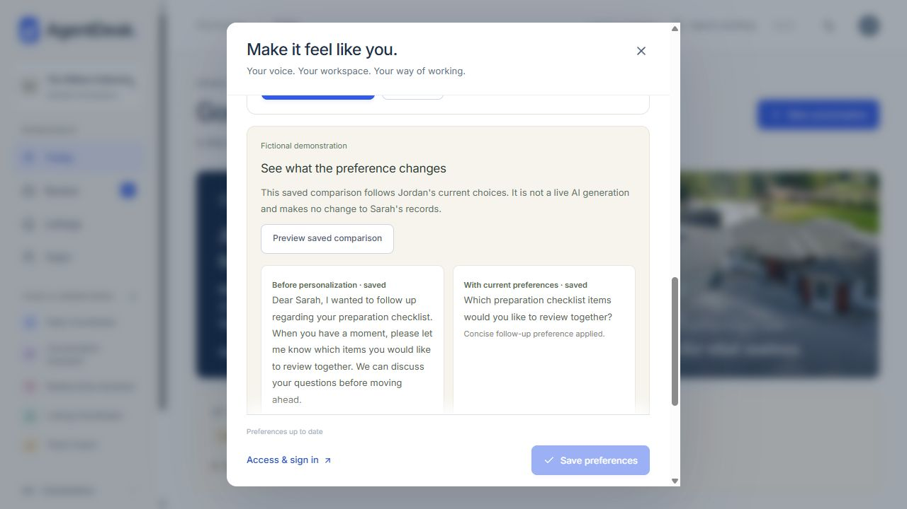

# Demonstrating Jordan's Agent Workstyle

This demonstration uses the existing six-agent fictional workspace. No Lofty credentials, external connection, or OpenAI key is required. The Sarah Mitchell relationship-intelligence and document-versioning demonstrations remain available.

1. Sign into the sample workspace and select **Jordan Ellis** in Settings. If a previous presentation changed the sample, use the existing guarded **Restore sample workspace** flow first. Restoration discards sample edits and recreates the fictional baseline; it does not reset private pilot accounts.
2. In **Settings → Agent Workstyle → Suggestions**, open **Make follow-ups more concise**. Explain that four saved fictional review examples show shortening and greeting removal across more than one client context. These are dedicated demonstration fixtures, not claims about a real employee.
3. Expand **See the recorded examples**. Compare original and approved excerpts, read the proposed length/greeting choices, and read exactly which future drafts would change. Nothing has been accepted yet.
4. Click **Use this preference**. In **Current preferences**, the two choices now show **Accepted suggestion** and their update time. The other agents' preferences remain unchanged.
5. Return to **Suggestions** and click **Preview saved comparison**. The shorter greeting-free version follows the accepted choices. Say: “This is a saved fictional comparison showing the effect. It was not generated live.” New authorized follow-up generation uses the same saved settings when OpenAI is configured.
6. Open **Recent changes → Undo**. The original values return. The accepted pattern does not repeatedly reappear. A manual change remains available under Current preferences.
7. Inspect **Remember your photography preparation step**. Four separate saved fictional seller-package reviews added the same approved checklist sentence. Accepting it includes that optional general guidance in future seller packages. It does not claim photography is booked, change Sarah's facts, or alter an approved PDF. **Customize** offers the supported alternative; **Not now · dismiss** preserves that decision.
8. Show **Suggest improvements from my reviews**. Turning it off stops new behavioral collection while retaining chosen preferences. Recent changes also lets the user clear stored behavioral examples without deleting the original reviewed work.

For a fuller demonstration, manually choose concise appointment briefings, bullet-point notes, or the appointment shortcut in Current preferences. The shortcut appears on Today for the next assigned appointment and opens its existing preparation flow; preparing and approving remain explicit steps. Live note/briefing generation requires the normal server-side OpenAI configuration and authorized source data.

The separate `/pilot` interface has a private, initially disabled learning profile for the authenticated member. Do not use the fictional presentation switcher to demonstrate private employee data. No live Lofty setup is needed for Friday.

See [implementation, privacy boundaries, and tests](WORKSTYLE.md) for the precise supported patterns and current limits.
